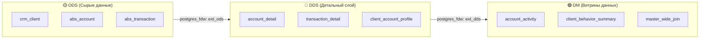

# 🚀 Vibe Stroy Data Catalog (DWH Data Catalog Generator)

[](https://nodejs.org/)
[](https://www.python.org/)
[](https://www.postgresql.org/)
[](https://esbuild.github.io/)
[](LICENSE)

Генератор автономного статического **Data Catalog & Lineage** для корпоративных хранилищ данных (DWH) на базе **PostgreSQL**.

Каталог собирается в полностью автономную папку `dist/` (`index.html` + бандлы JS/CSS) и работает локально прямо из браузера **без необходимости держать runtime backend или сервер приложений**.

---

## 🌟 Ключевые возможности

### 1. 📊 Интерактивный Table Lineage
* Полноценный граф зависимостей таблиц на основе алгоритма **Sugiyama** с адаптивным балансом скорости и качества.
* Ортогональная и плавная маршрутизация рёбер (Bezier routing), автоматический расчёт высот портов и предотвращение микроизломов связей.
* Поддержка кросс-базовых связей через **PostgreSQL FDW** (`postgres_fdw`).

### 2. 🔍 Column-Level Lineage & Propagation (Сквозной проброс колонок)
* Визуализация происхождения данных на уровне отдельных атрибутов (откуда пришло конкретное поле витрины).
* Алгоритм **Column Lineage Propagation** — сквозная трассировка по цепочке трансформаций: `ODS → DDS → DM`.

### 3. ⚡ Smart Execution Helper (Пересборка DWH)
* Интерактивный помощник для инженеров данных (Data Engineers).
* Позволяет выбрать целевую витрину и автоматически выгрузить правильную топологическую очередь выполнения SQL-скриптов с учётом всех родительских зависимостей и каскадной валидации.

### 4. 🔎 Быстрый полнотекстовый поиск и документация
* Мгновенный клиентский поиск по базам, схемам, таблицам и названиям колонок.
* Отображение метаданных DBeaver-формата: типы данных, комментарии бизнес-словаря, первичные ключи и системы-источники.

### 5. 📦 Режим поставки на Test (DDL + INSERT INTO)
* Автоматическая конвертация аналитических `CTAS`-скриптов dev-контура в релизный комплект поставки для test/prod:
  1. `CREATE TABLE` с типами данных и полным обвесом (PK, Unique, NOT NULL, комментарии, индексы, `ANALYZE`);
  2. `INSERT INTO <table> (<поля>) SELECT ...` для наполнения данными.
* Быстрое переключение режимов во вкладке «Скрипт» и независимое копирование каждого блока.

---

## 🏛 Архитектура DWH

Генератор ориентирован на классическую многослойную архитектуру DWH (Medallion architecture):



---

## 📁 Структура проекта

```text
├── scripts_for_test_dwh/     # 🛠 Скрипты инициализации тестовой песочницы DWH (ODS -> DDS -> DM)
│   ├── 01_init_ods.sql       # Создание таблиц ODS + наполнение данными
│   ├── 02_init_dds.sql       # Настройка FDW, создание детального слоя DDS + sql_inventory
│   ├── 03_init_dm.sql        # Настройка FDW, создание витрин DM + sql_inventory
│   └── README.md             # Инструкция по развёртыванию тестовой БД
├── lineage/                  # 🐍 Python-модули парсинга SQL и построения графов
│   ├── table_lineage.py      # Извлечение связей таблиц (sqlglot AST)
│   └── column_lineage.py     # Построение атрибутивного lineage
├── src/                      # ⚡ Клиентский JavaScript (ES modules)
│   ├── lineage/              # Алгоритмы визуализации графа, порты, drag/zoom
│   │   ├── tableLineage.js   # Sugiyama layout, рендеринг рёбер и нод
│   │   ├── tableLineageRebuild.js # Smart Execution Helper
│   │   └── columnLineagePropagation.js # Проброс колонок
│   └── index.js              # Точка входа бандла
├── templates/                # 🎨 Jinja2 HTML шаблоны
├── static/                   # 💎 Стили CSS, логотип и скомпилированный main.js
├── docs/                     # 📚 Документация архитектуры, алгоритмов и правил
├── generate_catalog.py       # 🚀 Главный entry point генерации каталога
├── metadata_loader.py        # Загрузка структуры БД из pg_catalog
├── sql_loader.py             # Загрузка и нормализация SQL из public.sql_inventory
├── site_builder.py           # Рендеринг HTML через Jinja2
├── config_catalog.example.json # Шаблон конфигурации подключения к БД
├── package.json              # Конфигурация сборки JS (esbuild) и тестов
└── requirements.txt          # Python зависимости
```

---

## 🚀 Быстрый старт

### 1. Клонирование репозитория и установка зависимостей

```bash
git clone https://github.com/dark-rider12/vibe_stroy_data_catalog.git
cd vibe_stroy_data_catalog

# Установка Python-библиотек
pip install -r requirements.txt

# Установка Node.js зависимостей (esbuild для фронтенда)
npm install
```

### 2. (Опционально) Развёртывание тестового DWH

Если у вас нет готового DWH, разверните демонстрационную песочницу из папки `scripts_for_test_dwh/`:

```bash
# В PostgreSQL создайте 3 базы данных:
# CREATE DATABASE ods; CREATE DATABASE dds; CREATE DATABASE dm;

psql -U postgres -d ods -f scripts_for_test_dwh/01_init_ods.sql
psql -U postgres -d dds -f scripts_for_test_dwh/02_init_dds.sql
psql -U postgres -d dm  -f scripts_for_test_dwh/03_init_dm.sql
```

### 3. Настройка подключения

Скопируйте пример конфига в рабочий файл `config_catalog_gemini.json`:

```bash
cp config_catalog.example.json config_catalog_gemini.json
```

Укажите реквизиты доступа к вашей базе данных PostgreSQL:
```json
{
  "db_host": "localhost",
  "db_port": "5432",
  "db_user": "postgres",
  "db_password": "YOUR_PASSWORD",
  "databases": ["ods", "dds", "dm"],
  "schemas": ["core", "calc"],
  "output_file": "dist/index.html"
}
```

> 🔒 *Примечание: Файл `config_catalog_gemini.json` находится в `.gitignore` и защищён от случайного коммита.*

### 4. Сборка JavaScript бандла

```bash
npm run build:js
```

### 5. Генерация каталога данных

```bash
python generate_catalog.py
```

Готовый статический каталог будет сгенерирован в папке `dist/`. Откройте `dist/index.html` в любом браузере!

---

## 🧪 Тестирование

Проект включает автоматизированные Node.js тесты визуального построения Lineage графов (проверка высот портов, транзитных коридоров и выявление микроизломов):

```bash
npm test
```

---

## 📄 Лицензия

Проект распространяется под лицензией [MIT](LICENSE).
